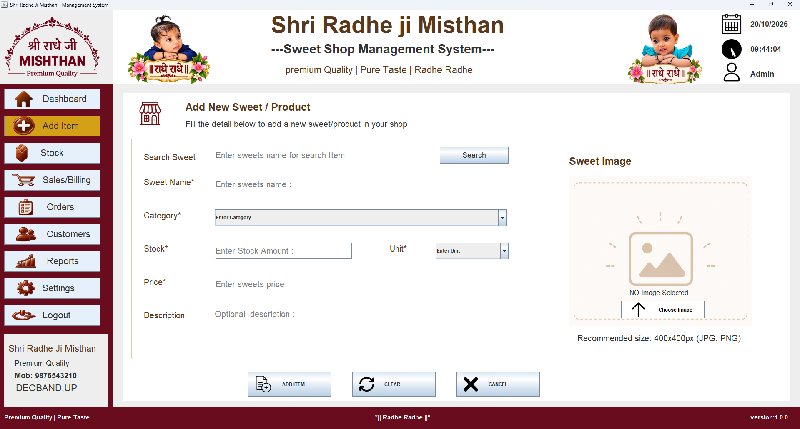
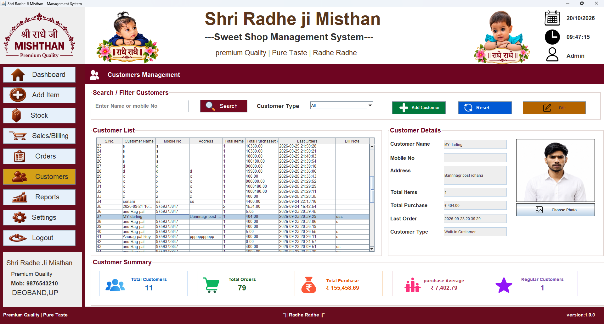
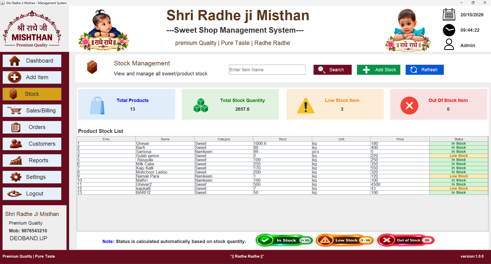
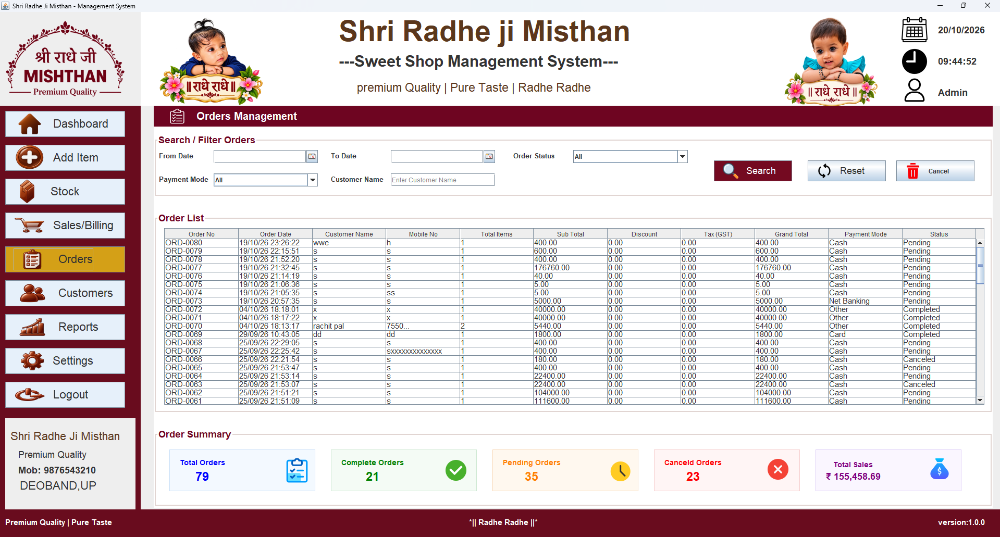

# Shri Radhe Ji Misthan
## Sweet Shop Management System

A desktop application developed using Java Swing and MySQL to manage sweet shop operations.

### Features
- Login 
- Dashboard
- Product Management
- Stock Management
- Sales and Billing
- Customer Management
- Order Management
- Sales Reports
- Payment Summary

### Technologies Used
- Java
- Java Swing
- MySQL
- JDBC

### Requirements
- Java JDK
- MySQL Server
- MySQL Connector/J

### Developer
Shri Radhe Ji Misthan Management System

### Version
1.0.0

# Employee Management System

A Java-based Employee Management System built using Java Swing and MySQL.

## 🔐 Login Page

## 🏠 Dashboard

## ➕ Add Employee

## 👥 Customers

## 📦 Stock Management

## 💰 Sales Management

## 📋 Orders

## 📊 Reports

